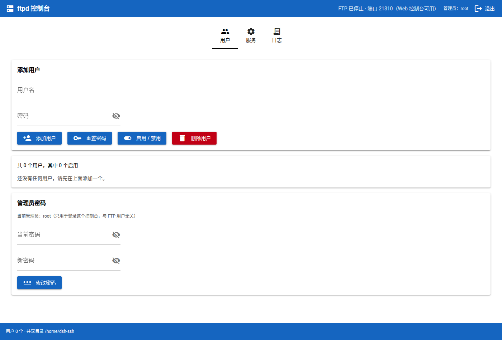
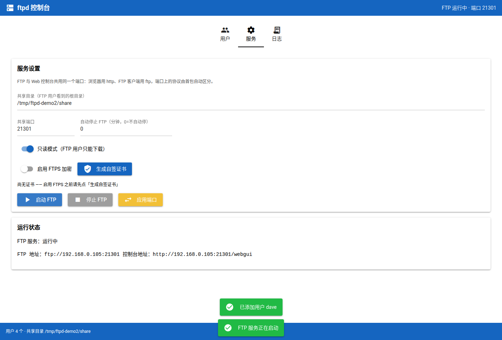
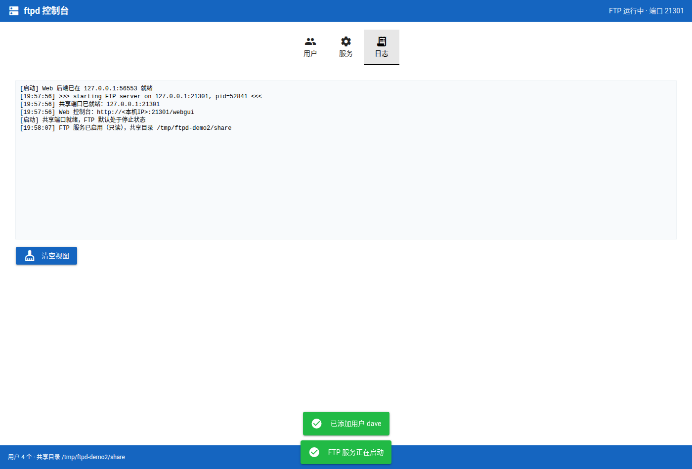

# ftpd —— FTP 服务器 + Web 控制台，**共用一个端口**

一个带用户管理界面的 FTP 服务器。浏览器打开 `https://<本机IP>:2121/webgui` 就是控制台，
FTP 客户端连 `ftp://<本机IP>:2121` 就是 FTP 服务——**同一个端口**。

这个项目最初是大二的一份作业：一个 34 行、匿名只读、用命令行问答启动的临时分享脚本。
后来逐步长成了现在这个样子：SQLite 用户库、密码哈希、带登录和 HTTPS 的控制台、FTPS 加密，
还修掉了当年留下的几个 bug。

## 截图

| 首次运行：初始化管理员 | 控制台登录 |
| --- | --- |
|  |  |

| 用户管理 | 服务配置与运行状态 | 实时日志 |
| --- | --- | --- |
|  |  |  |

## 核心设计：一个端口怎么同时跑 FTP、HTTP 和 HTTPS

FTP 和 HTTP 是两种不同的应用层协议，**一个 TCP 端口上并不存在「按 URL 路径路由」这回事**——
浏览器打开 `ftp://host:2121/webgui` 只会说 FTP 协议，永远到不了 HTTP 服务。

所以这里的做法是：自己监听那个端口，靠**首包特征**判定协议，再分流。

| 首包长什么样 | 判定 | 去向 |
| --- | --- | --- |
| `\x16\x03` 开头 | TLS 握手（ClientHello） | 内部 HTTPS 后端 |
| `GET ` / `POST` / … | 明文 HTTP 请求 | 内部 HTTP 后端（强制 HTTPS 时改成 301 跳转） |
| `USER ` 之类的大写命令 | 少数客户端会先发命令 | pyftpdlib |
| 什么都不发 | FTP 客户端在等问候语 | pyftpdlib |

关键点：HTTP/HTTPS 客户端一连上就发数据，一读就知道；FTP 客户端相反，它**等服务器先发 220 问候语**，
所以「沉默」本身就是 FTP 的特征（代价是 FTP 连接要多等一小会儿，见「已知限制」）。

判定为 FTP 后**不做字节代理**，而是把已经接受的 socket 原样交给
`FTPServer.handle_accepted()`。这一点很重要：pyftpdlib 看到的客户端地址就是真实地址，
日志里不会全变成 `127.0.0.1`，被动模式绑定的也是真实网卡地址。

Web 那一侧要转发（后端是另一个进程内的 uvicorn），转发时会把真实来源写进
`X-Forwarded-For`，并让 uvicorn 信任来自回环的该头部。

```
                     ┌──────────────────────────────────────────┐
   HTTPS 浏览器 ──TLS─▶│                                        │
   HTTP  浏览器 ─HTTP─▶│  MultiplexedFTPServer                  │
   FTP 客户端  ─FTP──▶│  （持有共享端口，首包嗅探）             │
                     └───┬──────────┬──────────────┬──────────┘
                         │ TLS      │ HTTP         │ FTP：socket 原样交接
                         ▼          ▼              ▼
                  HTTPS 后端    HTTP 后端      pyftpdlib 的 FTPHandler
                  （uvicorn）   （uvicorn）    （真实客户端 IP 保留）
                         └────┬─────┘
                    同一个 FastAPI 应用对象
```

**只会起一个 Web 后端**：有证书就走 HTTPS，没有就走明文。所以强制 HTTPS 其实是
「没有明文后端」的自然结果——明文请求由复用器直接 301 跳过去，不经过后端。

一开始我确实让 HTTP 和 HTTPS 各起一个 uvicorn、共用一个 NiceGUI 应用对象，
结果服务端开始刷 `IndexError: pop from empty list`：NiceGUI 的 `Slot.stacks` 是
模块级全局字典、按 asyncio 任务 id 索引（`nicegui/slot.py`），两个事件循环同时用它
会出现 id 复用。既然一个 NiceGUI 应用不能挂两个事件循环，就改成单后端了。

## 那 FTP 为什么要等一会儿？能不能不等？

**因为 FTP 是服务器先说话。** 协议规定服务端一连上就发 `220 ...` 问候语，客户端在那之前
一个字节都不发。所以「FTP 连接的首个数据包」并不存在——那个包应该由我们发出去：

* 不判定就不敢发问候语；
* 不发问候语客户端就永远沉默。

HTTP/TLS 客户端相反，一连上就把请求发出来，所以一看就知道、**零等待**；
只有「一声不吭」的连接才需要等到超时，而沉默本身就是 FTP 的特征。

**等多久是策略问题，不是实现细节。** 它取决于「HTTP 客户端把请求发出来需要多久」，
本质上是一个网络往返：局域网零点几毫秒，公网可能上百毫秒。实测的边界很清楚
（在这台机器上，宽限期 150ms）：

| 请求延迟 | 判定结果 |
| --- | --- |
| 0 / 20 / 50 / 100 / 140 ms | HTTP ✅ |
| 200 / 400 ms | 被误判成 FTP ❌ |

也就是说误判临界点**正好就是宽限期本身**。所以：

* 只在局域网用（比如家里），可以放心调小：`--classify-grace 0.03`，FTP 连接几乎无感；
* 要面对公网或较慢的客户端，就保持默认 150ms，或者调更大。

### 试过「按 RTT 自适应」，但不可靠

Linux 的 `TCP_INFO` 里有内核估的 RTT（`tcpi_rtt`），我一度用它把等待压到 `3×RTT + 5ms`，
在这个仓库里留成了 `--adaptive-grace` 开关，但**默认关闭**，原因是实测发现它会出事：

服务端读到的 RTT 只是**到最近一跳**的往返。中间只要隔着代理、负载均衡或转发层，
这个值就会严重偏小——本机的回环 TCP 被转发层隔开，服务端 socket 报的 RTT 只有约 1ms，
而真实客户端其实在 139ms 之外。结果宽限期被算成 8ms，**连「连上就立刻发请求」的
HTTP 客户端都被误判成 FTP**（实测收到 `421`）。

只有在服务端能直接看到客户端（没有中间层）时它才是对的。所以它是个显式开关，不是默认行为。

## 快速开始

需要 **Python 3.10 或以上**（NiceGUI 的要求；系统自带的 3.14 完全可用）。

```bash
./setup.sh          # 建 .venv 并安装依赖
./run.sh            # 启动
```

首次启动时终端会打印访问地址和一段**初始化口令**：

```
ftpd 已启动。
  Web 控制台：https://192.168.0.105:2121/webgui（自签证书，浏览器会提示不受信任）
  FTP 登录  ：ftp://<本机IP>:2121   （先到控制台添加用户并启动 FTP）
  控制台策略：HTTPS（明文请求会 301 跳转）

！还没有设置管理员：第一个打开控制台的人可以设置它。
  初始化口令：i2ElfVKIVZtx
  （从本机访问不需要口令；其它机器必须把这个口令填进初始化页）
```

然后：

1. 浏览器打开上面的 https 地址，自签证书会提示不受信任，选择继续即可；
2. 设置管理员账号（**从别的机器访问需要填那串口令**）；
3. 登录后到「用户」页添加 FTP 账号；
4. 到「服务」页选好共享目录，点「启动 FTP」；
5. 之后就能用 FTP 客户端连 `ftp://<本机IP>:2121` 了。

常用参数：

```bash
./run.sh --port 2323             # 换共享端口
./run.sh --db /path/to/users.db  # 换用户数据库
./run.sh --host 127.0.0.1        # 只监听回环
./run.sh --no-console-tls        # 控制台不用 HTTPS（这时就没有 HTTPS）
./run.sh --classify-grace 0.08   # 首包判定最多等多久（秒）
```

## 功能

### 控制台登录与 HTTPS

* 首次运行引导创建管理员；之后所有页面都要求登录；可改密、可登出；
* **默认走 HTTPS**（有证书时）：明文请求会被 301 跳到 https，管理员密码不再明文过网；
  想用明文就用 `--no-console-tls` 启动，这时不会有 HTTPS；
* 证书是首次启动自动生成的自签证书，SAN 里带上了本机所有局域网 IP，
  所以用 IP 访问不会额外报「名称不匹配」；
* 登录失败会被限流。

### 用户管理（SQLite）

* 增删用户、重置密码、启用/禁用；
* 密码用 **PBKDF2-HMAC-SHA256、20 万次迭代、每用户独立随机盐**存储，
  格式 `pbkdf2_sha256$迭代次数$盐$哈希`，库里没有任何明文；管理员密码同样处理；
* 校验用 `hmac.compare_digest` 常量时间比较，且不区分「用户不存在」和「密码错误」，避免用户名枚举；
* 用户名大小写不敏感，规则：字母数字加点/下划线/连字符，1–32 位。

数据库默认在 `~/.local/share/ftpd/users.db`，证书在 `~/.local/share/ftpd/tls/`。

### 服务配置

* 共享目录、共享端口、只读/读写切换；
* **FTPS**：勾选后要求控制通道与数据通道都加密（`AUTH TLS` / `PROT P`）；
* **自动停止**：设定分钟后自动停用 FTP，界面显示倒计时；
* **改端口**：会先让浏览器挂上跳转脚本，切换后自动跟到新地址，不会停在白屏。

### 权限模型

按需求做的是「**只做登录，权限统一**」：所有 FTP 账号共享同一个目录、同一套权限，
只在服务级别切只读 / 读写。只读权限是 `elr`（进目录、列目录、下载），
读写再叠加 `adfmwMT`（上传、删除、改名、建目录等）。

## 安全性说明

### 传输加密

* **控制台默认 HTTPS**（自签证书）。管理员密码不再明文过网；
* **FTPS 需要手动打开**（「服务」页的开关）。FTP 本身是明文协议，
  用户名密码和传输内容都不加密，条件允许就打开它；
* 自签证书首次访问会被浏览器拦一下，这是正常的，确认继续即可。

### 防暴力破解

`ftpd/security.py` 里的 `LoginThrottle` 同时给 FTP 和控制台登录用：

* **用户名和来源 IP 都计数**——只记用户名会被换名字绕过，只记 IP 会被分布式绕过；
* 窗口内（默认 5 分钟）失败 5 次就临时锁定 15 分钟，到点自动解除；
* 锁定期间即使密码正确也拒绝，界面上会显示当前被锁的 key 和剩余时间；
* 计数表有容量上限，被「换用户名刷」时不会无限膨胀，且不会淘汰正在生效的锁定。

### 首次初始化的口令

在设置管理员密码之前，任何能连到端口的人都能打开初始化页。为此启动时会生成一段一次性口令：

* **从本机（回环）访问不需要口令**——能操作本机的人本来就有 shell 权限；
* **其它来源必须填对口令**，否则无法创建管理员。

这样「谁先打开谁当管理员」的窗口就被堵住了。

### 其它

* 只读模式下用户无法上传或删除，这是默认值；
* 共享目录建议单独开一个，不要把家目录整个共享出去；
* 控制台监听 `0.0.0.0`；如果这台机器在不可信网络里，请用 `--host 127.0.0.1`
  只监听本机，或者自己加一层反向代理。

## 修复与改进

### 1. 原版的「自动停止后进程不退出」（`ftpd.py` 时代就有的）

原脚本用 `threading.Timer` 到点调用 `server.close_all()`。端口确实释放了，连接也断了，
但主线程仍然阻塞在 pyftpdlib 事件循环的 `poll(None)` 里——因为 `loop()` 是
`while socket_map: poll(timeout)`，无限超时的 `poll` 在 socket 表被清空后**永远不会醒来重新检查**。
结果就是：看起来停了，进程却挂在那儿，得手动 Ctrl-C。

现在给 `serve_forever(timeout=0.5)` 一个超时，事件循环每 0.5 秒回头检查一次，
`close_all()` 之后能正常返回、线程正常结束。

### 2. 转发时的半关闭数据丢失

HTTP/WebSocket 转发用的 select 泵最初实现成：一端读到 EOF 就立刻对另一端
`shutdown(SHUT_WR)`。但如果此时另一端还有数据躺在用户态缓冲里没交给内核，
**这些数据会被静默丢掉**。测试里用 256 KB 往返抓到了它：后端收全了 262144 字节，
客户端只拿到 236544 字节，前缀一致、尾部消失。修复方式是**等缓冲排空之后再半关闭**。

### 3. 长连接把分类线程池占满，把 FTP 饿死

`handle_accepted` 曾把任务丢进线程池，而任务里直接跑 `proxy_to`——那是**整条连接的寿命**。
几条挂着不动的 Web 连接就能占满 worker，FTP 连问候语都收不到（用 2 个 worker +
3 条连接复现：FTP 连接 8 秒超时）。现在分类只做判定，转发交给独立线程并加信号量限流。

### 4. 换端口相关的三处

* 新端口不可用时会先试绑，不可用就原地报错，**不会**先关掉旧端口让服务彻底没入口；
* 换端口不再顺手把 FTP 停掉，会沿用原配置继续跑；
* 转发中的连接会登记，关闭服务时一并回收（它们不在 ioloop 的 socket_map 里）。

### 5. 控制台鉴权与限流

原本控制台谁都能打开、谁都能建用户启服务。现在有管理员登录、首次初始化口令、
会话保持、改密与登出，登录同样受限流保护。

### 6. 真实客户端 IP

Web 后端跑在回环地址上，原本它看到的客户端都是 `127.0.0.1`。现在转发时会往首个请求里
插入 `X-Forwarded-For`，并让 uvicorn 信任来自回环的该头部。

### 7. 顺手治掉的几处

* NiceGUI 的会话存储默认写在 `./.nicegui`，会污染仓库，现在挪到应用数据目录；
* 页面级跳转必须 `return RedirectResponse(...)`（`ui.navigate.to` 在页面函数里无效——
  那时浏览器还没连上，JS 发不出去）；
* 事件处理器里的跳转路径不能再带挂载前缀，否则会变成 `/webgui/webgui/`；
* 首包判定的等待从「5ms 轮询」改成 `select`，不再空转 CPU，也能立刻被数据唤醒。

## 项目结构

```
ftpd/
├── ftpd/
│   ├── app.py        装配与命令行入口
│   ├── config.py     路径与默认值
│   ├── db.py         SQLite 用户库、密码哈希、管理员凭据
│   ├── security.py   登录限流
│   ├── auth.py       数据库驱动的 pyftpdlib 认证器
│   ├── server.py     FTP 服务生命周期（共享端口、启停、日志、自动停止）
│   ├── multiplex.py  单端口协议复用：首包嗅探 / socket 交接 / TLS 与 HTTP 分流
│   ├── webgui.py     NiceGUI 控制台（挂在 /webgui），含登录与双 uvicorn 后端
│   ├── net.py        本机地址探测
│   └── tls.py        自签证书生成
├── tests/            148 个测试
├── tools/browser_check.py   用真实浏览器做端到端自检（开发用）
├── legacy/           封存的旧版 Kivy 桌面界面（仅存档，不再维护）
├── docs/screenshots/
├── setup.sh / run.sh
└── requirements*.txt
```

## 测试

```bash
.venv/bin/python -m pytest tests/ -q
```

| 文件 | 内容 |
| --- | --- |
| `test_db.py` | 密码哈希、加盐、校验、输入规则、用户增删改查、管理员凭据、会话密钥 |
| `test_security.py` | 限流的窗口、锁定、过期、按用户名/按 IP 计数、并发记账、容量上限 |
| `test_auth.py` | 认证器确实走 SQLite、禁用用户被拒、内存里没有明文密码、限流接入 |
| `test_console_auth.py` | 控制台登录与初始化的纯逻辑（成功、错密码、锁定、按 IP 隔离、初始化口令） |
| `test_multiplex.py` | 首包嗅探（TLS / HTTP 各方法 / FTP 命令 / 沉默 / 对端关闭）、`X-Forwarded-For` 注入、请求行解析、502 兜底 |
| `test_server.py` | 启停、端口释放、TLS、只读限制、**真实客户端 IP 不丢失**、事件循环线程真正退出、FTP 登录被限流、**慢 Web 连接不饿死 FTP**、换端口不丢服务 |
| `test_webgui.py` | 端到端：同一端口上 HTTPS 控制台 / `/healthz` / FTP 并存、明文请求被 301 跳转、控制台鉴权跳转 |

### 为什么还需要浏览器自检

`build_page` 只在真实浏览器里执行，pytest 碰不到它——本项目已经**两次**出现
「pytest 全绿、但打开控制台是 500」。所以留了一个脚本，用真实浏览器跑完整流程：

```bash
pip install playwright        # 不在项目依赖里
python tools/browser_check.py --port 21310 --chrome /opt/google/chrome/google-chrome
```

它会走：初始化管理员 → 登录 → 界面加用户 → 启动 FTP → 用 FTP 客户端验证 →
改端口 → 确认页面自动跳转且 **FTP 仍在运行**。

## 已知限制

1. **每个 FTP 连接会多等一点**：必须等一小段时间才能判断「一声不吭」的是 FTP 客户端。
   默认 150ms，可用 `--classify-grace` 调整——纯局域网可以调到 30ms 左右，
   面向公网就别调小（见上文「那 FTP 为什么要等一会儿」）。
2. **HTTP 的 keep-alive 后续请求拿不到 `X-Forwarded-For`**：只在每条连接的**首个请求**
   上注入了该头部。页面加载和 WebSocket 握手都是新连接，所以实际影响很小；
   但如果后端要做按 IP 的精细统计，需要改造成逐请求改写（要做对得先实现 HTTP 分帧）。
3. **同一进程只能有一个共享端口**：pyftpdlib 的 `IOLoop` 是进程级单例，
   一个进程里不能同时跑两个 `FTPServer`。本项目只需要一个。
   同理，**控制台要么 HTTPS 要么明文，不能两者同时提供**——
   一个 NiceGUI 应用不能挂两个 asyncio 事件循环（见上文「核心设计」）。
4. **自签证书的浏览器警告**：无法避免，除非换成受信任的证书。
5. **改端口时若探测被证书拦住**，跳转脚本会在重试若干次后直接跳过去——
   用户需要在新地址上再接受一次证书。
6. **初始化口令只存在于内存**：进程重启会换一个新的（仅限还没设置管理员的阶段）。

## legacy 目录

`legacy/` 里是这中间做过的一版 **Kivy 桌面界面**（含 `.kv` 布局、中文字体注册、
截图脚本和冒烟测试），按约定封存保留。它对应的是重构前的服务 API，**不能直接运行**，
只作为过程存档。现在的界面是 `ftpd/webgui.py`。

换掉 Kivy 的原因：Kivy 2.3.1 没有 Python 3.14 的官方轮子（PyPI 上只到 cp313），
在这台机器上装它需要退化成源码编译并依赖 SDL2 开发头文件；
而 NiceGUI 是纯 Python 轮子，声明支持 3.10–3.14，装起来毫无摩擦，还顺带把界面从桌面搬进了浏览器。

## 来历

* 2025-05-24 ~ 05-26：最初的 34 行匿名只读 FTP 分享脚本（10 个提交）。
* 第一次重构：SQLite 用户管理 + Web 控制台 + 单端口协议复用 + 修复上述 bug 1、2。
* 第二轮：控制台鉴权与登录限流 + 真实客户端 IP + 可配置判定宽限期 + 改端口自动跳转。
* 第三轮：修复并发与换端口的缺陷（bug 3、4）+ 浏览器自检脚本。
* 第四轮：控制台 HTTPS（嗅探 TLS 并分流）+ 首次初始化口令 + 首包判定改 select + 证书生效链路。
  中途发现「一个 NiceGUI 应用挂两个事件循环」会崩，于是收敛成单后端。
